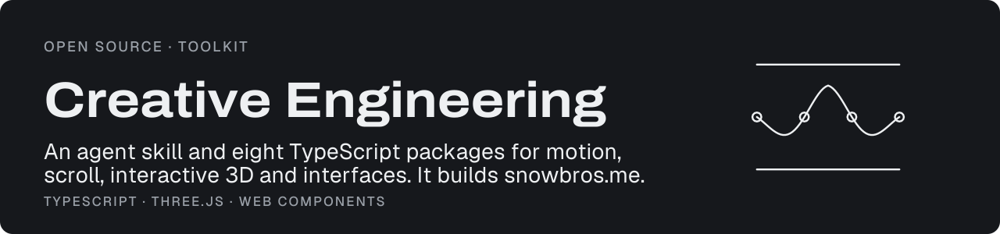
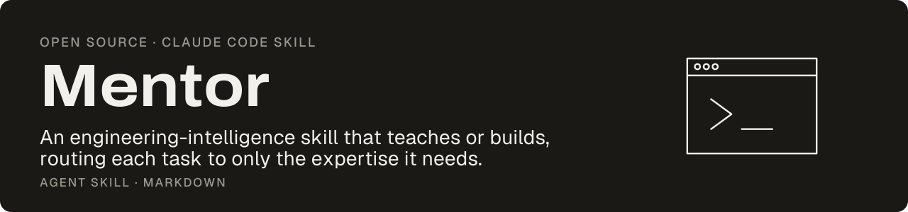
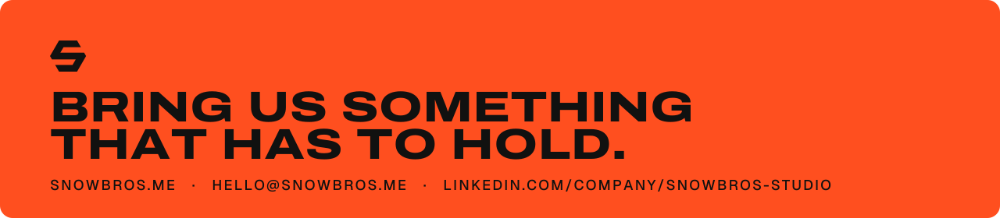

<div align="center">

<a href="https://snowbros.me"></a>

**[snowbros.me](https://snowbros.me)** &nbsp;/&nbsp; **[Start a project](https://snowbros.me/#contact)** &nbsp;/&nbsp; **[LinkedIn](https://www.linkedin.com/company/snowbros-studio/)** &nbsp;/&nbsp; **[hello@snowbros.me](mailto:hello@snowbros.me)**

</div>

<br>



## `01 // OPEN SOURCE`

<a href="https://github.com/snowbros-labs/atlas"></a>

**[Atlas](https://github.com/snowbros-labs/atlas)** · our flagship. A Rust engine with one semantic model of the whole project: import graph, call graph, framework boundaries. It reports circular imports, dead code, Next.js server code leaking into client components and hardcoded secrets, each with the chain of evidence. CLI, language server and VS Code extension. Same code in, same findings out.

```sh
npx snowbros analyze
brew install snowbros-labs/tap/snowbros-atlas
```

[](https://crates.io/crates/snowbros-atlas)
[](https://www.npmjs.com/package/snowbros)
[](https://marketplace.visualstudio.com/items?itemName=snowbros.snowbros-atlas)

<a href="https://github.com/snowbros-labs/creative-engineering"></a>

**[Creative Engineering](https://github.com/snowbros-labs/creative-engineering)** · the toolkit behind [snowbros.me](https://snowbros.me). See every package running in [the lab](https://snowbros.me/lab.html).

<a href="https://github.com/snowbros-labs/mentor-skill"></a>

**[Mentor](https://github.com/snowbros-labs/mentor-skill)** · a Claude Code skill that teaches or builds, routing each task to only the expertise it needs. Plus our **[Homebrew tap](https://github.com/snowbros-labs/homebrew-tap)**.

## `02 // STUDIO WORK`

Products we designed, engineered and shipped in 2026. Cards link to source or the live product.

<table>
<tr>
<td width="50%"><a href="https://nova.snowbros.me"></a></td>
<td width="50%"><a href="https://swiftdrop.snowbros.me"></a></td>
</tr>
<tr>
<td width="50%"><a href="https://github.com/VED2107/accounic"></a></td>
<td width="50%"><a href="https://amr-drug-repurposing.vercel.app"></a></td>
</tr>
</table>

<details>
<summary><b>+ The full index</b></summary>

<br>

| Project | What it is | Links |
|:--|:--|:--|
| **NOVA** | Privacy-first desktop media player: Rust, Tauri 2 and libmpv. Shows only what the engine confirms. | [Site](https://nova.snowbros.me) · [Source](https://github.com/VED2107/nova) |
| **SwiftDrop** | Photos and files between phone and PC over your own Wi-Fi. No cloud, no account. | [Site](https://swiftdrop.snowbros.me) · [Source](https://github.com/VED2107/swiftdrop) |
| **Accounic** | Multi-currency ledger: web, Android and Windows on one Postgres schema that owns every balance. | [Source](https://github.com/VED2107/accounic) |
| **AMR Screening** | 1,761 approved medicines screened against four drug-resistant bacteria. Co-led by our founder with Yash Prajapati for Ganpat University's pharmacy college. | [Site](https://amr-drug-repurposing.vercel.app) · [Source](https://github.com/amrdrugrepurposing/amr-drug-repurposing-1) |
| **STC Academy** | Teaching platform for CBSE and GSEB students, with an admin command centre. Client work. | [Source](https://github.com/VED2107/STC) |
| **Vinny's Atelier** | The retail system a fashion boutique bills on every day: offline-first till, Razorpay UPI, 268 tests. | Private client system |
| **Lunora Studio** | Handmade-bouquet store with a scroll-told landing page. | [Source](https://github.com/VED2107/lunora-studio) |

Case studies with real screens: [snowbros.me/#work](https://snowbros.me/#work)

</details>

<br>

<a href="https://snowbros.me/#contact"></a>

<div align="center">
<sub>SNOWBROS · independent engineering studio · founded by <a href="https://github.com/VED2107">Ved Chauhan</a> · <a href="https://snowbros.me/privacy.html">Privacy</a></sub>
</div>
